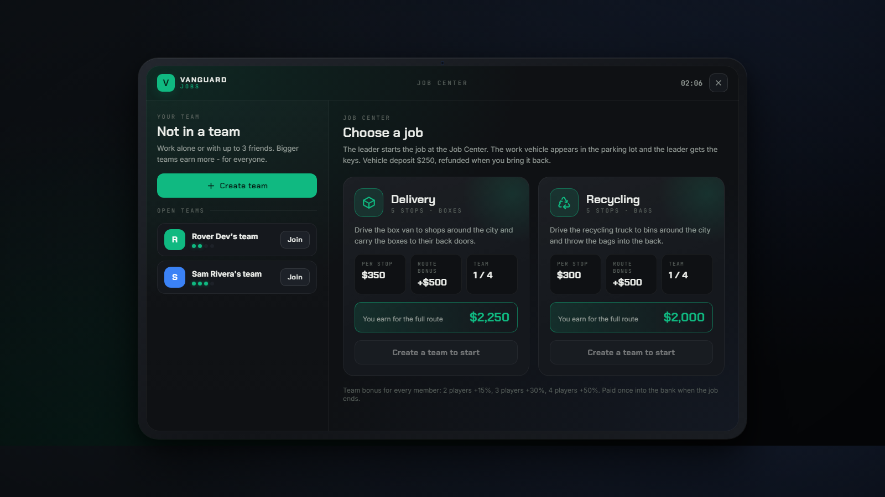
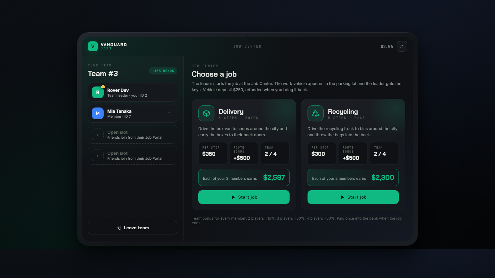
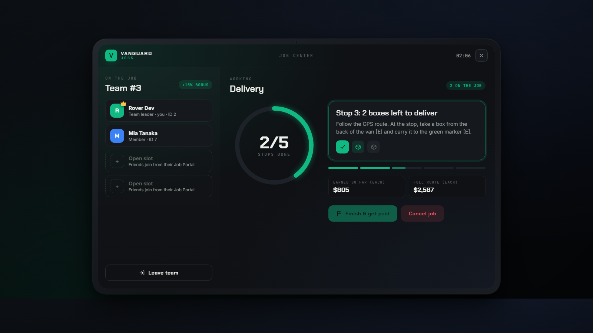

# Vanguard Jobs

Team jobs for FiveM QBCore servers. One **Job Center** NPC, one tablet-style **Job Portal**, and jobs you can do alone or with up to 3 friends. Bigger teams earn more, and everyone is paid once into the bank when the job ends.

Starts with two jobs, **Delivery** (box van to shop back doors) and **Recycling** (collection truck to bins). Adding more is a config entry.



## Features

- **Job Center**: an NPC with a map icon. Press **E** at the NPC to open the Job Portal. It's the only way to open it, so every player goes to the Job Center to get a job. No item needed.
- **Teams of up to 4**: create a team, join an open one, leave, or (as leader) kick. The leader starts and cancels jobs.
- **Team bonus for everyone**: 1 player 100 %, 2 players 115 %, 3 players 130 %, 4 players 150 % (`Config.TeamBonus`).
- **Work vehicle**: spawned in the Job Center parking lot when the job starts. It comes fully fuelled and the keys go to the team leader. It costs a deposit ($250), which is refunded when the vehicle is parked back at the Job Center.
- **Real GPS route**: each stop gets a waypoint route along the roads, and the stop and the back of the vehicle are marked.
- **Carry work**: take a box from the van and carry it to the shop door, or grab a bag from the bin and throw it into the truck. Anyone in the team can carry. **X** puts it down.
- **One payment at the end**: stops done × pay per stop, plus a route bonus for finishing every stop, times the team bonus. If the team cancels early, everyone is paid for the stops already done.
- **On-screen tracker** while working: current stop, items left, route progress.
- **Server-checked**: every action checks the player's team, the job phase and the distance to the stop or vehicle on the server. Requests are rate-limited.




## Requirements

- `qb-core`
- Optional: `qb-vehiclekeys` (keys for the leader), `qb-fuel` / `LegacyFuel` / `ps-fuel` / `cdn-fuel` (full tank)

## Installation

1. Put the `vanguard-jobs` folder in your `resources` folder.
2. Add to `server.cfg` after `qb-core`:

   ```cfg
   ensure vanguard-jobs
   add_ace group.admin vanguard.jobs.admin allow
   ```

3. Restart the server.
4. In game, move the Job Center to where you want it (admins only):
   - Stand where the NPC should be, face the way it should look, and type **`/jobcenter ped`**.
   - Stand (or sit in a car) where the work vehicles should appear, facing the road, and type **`/jobcenter parking`**.

   The spots are saved in `data/center.json` and survive restarts.

## Playing

1. Go to the Job Center (marked "Job Center" on the map) and press **E** at the NPC.
2. **Create team**. Friends come to the Job Center, open the portal and press **Join** on your team.
3. The leader picks a job and presses **Start job**. The deposit is taken from the leader's cash (or bank).
4. Get in the vehicle in the parking lot and follow the GPS route.
5. At each stop:
   - **Delivery**: walk to the back of the van and press **E** to take a box, then carry it to the green marker and press **E**.
   - **Recycling**: press **E** at the bin to grab a bag, then press **E** at the back of the truck to throw it in.
6. After the last stop, drive back to the Job Center parking lot. The leader presses **Finish & get paid**.

## Configuration

Everything is in `config.lua`:

| Setting | What |
|---|---|
| `Config.Center` | NPC model, default spots (overridden by `/jobcenter`), blip, interaction distances |
| `Config.MaxTeamSize` | Team size limit (default 4) |
| `Config.TeamBonus` | Pay percentage per team size |
| `Config.Deposit` | Vehicle deposit |
| `Config.Jobs.<id>` | Per job: label, vehicle model, plate, number of stops, items per stop, pay per stop, route bonus, carry animation and prop, stop coordinates |
| `Config.JobOrder` | Order of the job cards in the portal |

### Adding a job

Copy the `delivery` or `recycling` block in `Config.Jobs`, give it a new id, change the vehicle, pay and stop list, and add the id to `Config.JobOrder`. `pickup = 'vehicle', drop = 'stop'` carries from the vehicle to the stop. `pickup = 'stop', drop = 'vehicle'` carries from the stop to the vehicle.

## Development

```sh
npm install
npm test        # rules and team logic (Lua 5.3 via fengari)
npm run lint    # Lua syntax check
```

Open `html/index.html` in a browser for a preview with sample data. `#home`, `#team`, `#run` and `#tracker` pick the screen.

## License

MIT © 2026 Rover
